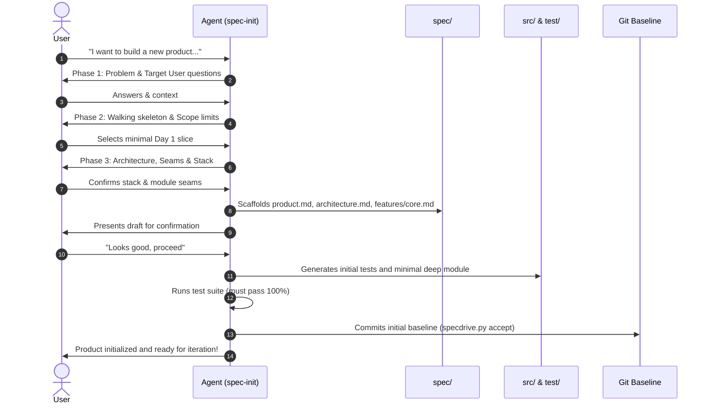

# Spec-Init

The `spec-init` skill is the single front door for onboarding any project into the SpecDrive **Spec-as-Source** paradigm.

When invoked, the skill inspects the repository and automatically operates in one of two modes:
* **Mode A: Greenfield Project (From Scratch)**: Conducts a discovery interview to scope a minimal initial product (the walking skeleton), drafts the foundational specifications, implements the working code and tests, and commits the initial baseline.
* **Mode B: Brownfield Project (Existing Codebase)**: Inspects the existing code, tech stack, and test suite, creates `spec/product.md` and `spec/architecture.md`, reverse-engineers initial capability specifications in `spec/features/`, tags existing tests with `@spec <ID>`, and commits the adoption baseline.

* **Interview Guide (Greenfield)**: [interview-guide.md](references/interview-guide.md)
* **Spec Format Reference**: [spec-format.md](../spec-author/references/spec-format.md)
* **Codebase Design Reference**: [codebase-design.md](../spec-author/references/codebase-design.md)
* **Helper Script**: `python scripts/specdrive.py <command>`

---

## Mode Detection

Upon activation, check the working directory:
1. Ensure Git is initialized:
   ```bash
   git status || git init
   ```
2. Determine repository state:
   - If the workspace has no existing source code files (or only empty scaffolding): **Execute Mode A (Greenfield)**.
   - If the workspace already contains existing application source code, package manifests (`package.json`, `pyproject.toml`, `Cargo.toml`, `go.mod`), or tests: **Execute Mode B (Brownfield)**.

---

## Mode A: Greenfield Product Discovery (From Scratch)



### 1. Discovery Interview
Follow [interview-guide.md](references/interview-guide.md):
- **Batch questions**: 2–3 questions per turn with recommended defaults.
- **Scope down**: Find the single, thinnest vertical slice (walking skeleton) that connects all layers end-to-end. Defer everything else to `## Out of scope`.
- **Confirm architecture**: Confirm runtime language, framework, database, dependency categories, module seams, and test harness.

### 2. Scaffold Core Structure & Specs
Run directory setup:
```bash
python scripts/specdrive.py init
```
Draft the foundational specs:
- `spec/product.md`: Vision, personas, glossary.
- `spec/architecture.md`: Stack, layout conventions, build/test commands, deep module boundaries, seam locations, and dependency categorization (in-process, local-substitutable, remote-owned ports/adapters, true external).
- `spec/features/<core-feature>.md`: First 2–4 EARS requirements with Given/When/Then acceptance criteria defining observable behavior at the primary seam.

### 3. User Approval Gate
Present a summary of the drafted specifications to the user:
> *"Here is the specification for the initial walking skeleton. Does this capture the scope you want for Day 1?"*

### 4. Synthesize Walking Skeleton
Once approved:
1. Create project config files (e.g. `pyproject.toml`, `package.json`, `Cargo.toml`).
2. Generate tests in `test/` verifying each acceptance criterion, tagged with `# @spec <ID>`. **The interface is the test surface**: tests cross the seam and assert on observable outcomes.
3. Generate minimal implementation in `src/` to satisfy tests, tagged with `# @spec <ID>`. **Build a deep module**: a compact interface with rich logic hidden behind the seam. Design for testability: accept dependencies, return results, avoid premature abstraction.
4. Run tests using the project's runner (must pass 100%).

### 5. Commit Baseline
```bash
python scripts/specdrive.py check
python scripts/specdrive.py accept -m "Initial product implementation: <feature>"
```

---

## Mode B: Brownfield Adoption (Existing Codebase)

When introducing SpecDrive to an existing codebase:

### 1. Stack & Architecture Inspection
- Inspect dependencies, build configs, and test setups.
- Identify the canonical test runner and execution command.
- Map existing module boundaries, seams, and dependency categories.

### 2. Layout Alignment
Ensure the project conforms to the three top-level directories:
- `spec/`: Created if absent.
- `src/`: Houses production code (or maps existing source root).
- `test/`: Houses test suites (or maps existing test root).
```bash
python scripts/specdrive.py init
```

### 3. Document Architectural Truth
- Generate `spec/architecture.md`: Record existing runtime, framework versions, directory structure, coding idioms, module seams, dependency categories, and exact test commands.
- Generate `spec/product.md`: Document current system purpose and core domain concepts.

### 4. Reverse-Engineer Initial Feature Specs
- Group existing capabilities into feature specs in `spec/features/*.md`.
- Assign permanent IDs (`CORE-001`, `AUTH-001`) to discrete behaviors verified by existing tests at module seams.
- Format requirements with EARS syntax and Given/When/Then acceptance criteria reflecting existing behavior.

### 5. Inject Traceability Tags
- Annotate existing tests with `# @spec <ID>` (or language-appropriate comment).
- Annotate corresponding primary classes/functions in `src/` with `# @spec <ID>`.

### 6. Verify & Establish Baseline
Run traceability integrity check:
```bash
python scripts/specdrive.py check
```
Commit the adoption baseline:
```bash
python scripts/specdrive.py accept -m "Adopt SpecDrive spec-as-source baseline"
```
