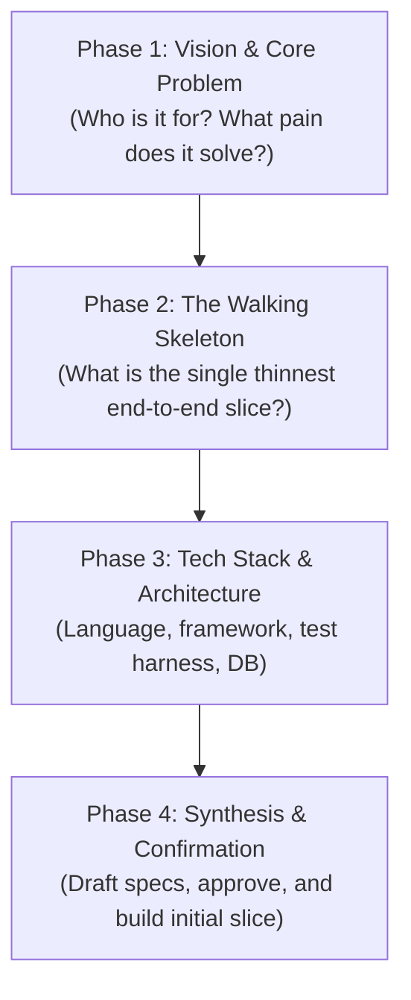

# Product Discovery & Initial Scope Interview Guide

This guide defines the conversational discovery process used by the `spec-init` skill when starting a new software product from scratch (Greenfield Mode).

The goal is to move from a raw idea to a **Working Walking Skeleton (MVP)** with minimum cognitive friction.

---

## The Four Interview Phases

Do not ask all questions at once. Batch them into 3–4 focused rounds of 2–3 questions each, providing recommended defaults for each choice.

---

### Phase 1: Vision & Core Problem
Ask:
1. **What is the product and what core problem does it solve?**
2. **Who is the primary user or consumer?** (e.g. End-user browser, CLI developer, another service via REST/gRPC).
3. **What is the working name of the project?**

*Guidance*: If the user provides a one-sentence summary (e.g., *"A CLI tool that tracks daily reading habits"*), reflect your understanding and immediately propose the primary actor and core purpose.

---

### Phase 2: The Walking Skeleton (The First Minimal Slice)
A "walking skeleton" is the thinnest possible vertical slice of functionality that connects all necessary layers end-to-end and can be verified by automated tests.

Ask:
1. **What is the single most critical capability the product must deliver on Day 1?**
   - E.g., for a reading tracker: *Log a book title and number of pages read today, and view total pages read.*
2. **What can we explicitly postpone to later iterations?**
   - Promptly suggest putting features like multi-user accounts, social sharing, cloud sync, or complex analytics into `Out of scope` for the initial slice.

---

### Phase 3: Technical Stack & Architecture
Ask:
1. **Target Language & Framework**:
   - Provide a recommended default based on the domain (e.g., Python + Click/FastAPI, TypeScript + Node/Hono, Go, Rust).
2. **Persistence / Storage**:
   - Recommend the simplest viable option for the initial slice (e.g. SQLite, JSON file, in-memory, or PostgreSQL).
3. **Testing Framework**:
   - Confirm the test runner (e.g. `pytest`, `vitest`, `cargo test`, `go test`).

---

### Phase 4: Synthesis & Confirmation
Before writing any code:
1. Produce the drafted specifications:
   - `spec/product.md`
   - `spec/architecture.md`
   - `spec/features/<core-feature>.md` (with 2–4 concrete EARS requirements and Given/When/Then acceptance criteria).
2. Present a concise summary to the user:
   - *"Here is the specification for the initial walking skeleton. Does this capture the scope you want for Day 1?"*
3. Once the user approves (or requests small tweaks), hand off directly to implementation: generate the code and tests, run the test suite, and record the initial baseline.
