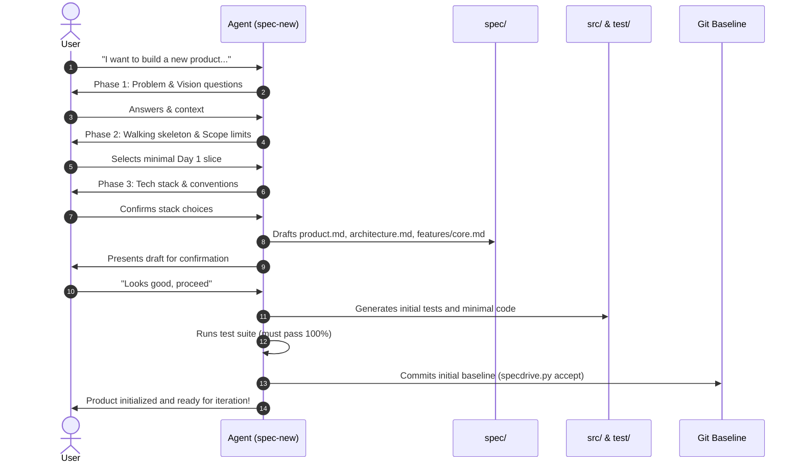

# Spec-New

The `spec-new` skill is the entry point for starting a **new software product from scratch**.

Instead of guessing requirements or generating speculative boilerplate, this skill conducts a focused discovery interview to clarify the product's purpose and isolate its **initial walking skeleton (MVP)**. It then writes the foundational specifications, implements the initial slice, verifies it with automated tests, and creates the first baseline commit.

* **Interview Guide & Phasing**: [interview-guide.md](references/interview-guide.md)
* **Spec Format Reference**: [spec-format.md](../spec-author/references/spec-format.md)
* **Helper Script**: `python .agents/skills/spec-sync/scripts/specdrive.py <command>`

---

## The Guided Process



---

## Step-by-Step Execution

### Step 1: Environment & Repository Check
1. Ensure Git is initialized in the working repository:
   ```bash
   git status
   # If not a repository, run: git init
   ```
2. Run directory initialization:
   ```bash
   python .agents/skills/spec-sync/scripts/specdrive.py init
   ```
   Ensures `spec/`, `spec/features/`, `src/`, and `test/` exist.

---

### Step 2: The Discovery Interview
Engage the user in a short, conversational interview. Adhere strictly to these principles:
- **Batch questions**: Ask at most 2–3 questions per turn.
- **Provide defaults**: Always suggest sensible, battle-tested options (e.g. *"I recommend SQLite + FastAPI for the initial slice. Does that work for you?"*).
- **Relentlessly scope down**: Identify the single, thinnest end-to-end slice (the walking skeleton) that can be verified immediately. Move everything else to `## Out of scope`.

Cover the phases defined in [interview-guide.md](references/interview-guide.md):
1. **Vision & Target Users**: Problem statement, primary actors, project name.
2. **The Walking Skeleton**: The single primary user journey to prove end-to-end on Day 1.
3. **Tech Stack & Tooling**: Programming language, framework, database, test runner, and linting tools.

---

### Step 3: Draft Foundational Specifications
Once the user confirms the scope and architecture, draft the following files in `spec/`:

1. **`spec/product.md`**:
   - Product vision and problem statement.
   - Target personas.
   - Glossary of core domain concepts.
2. **`spec/architecture.md`**:
   - Language runtime, frameworks, and database choices.
   - Directory structure conventions for `src/` and `test/`.
   - Exact CLI commands to build, run, and test the project.
3. **`spec/features/<core-feature>.md`**:
   - Feature specification for the walking skeleton using a 3–4 letter uppercase prefix (e.g. `CORE`, `CLI`, `AUTH`).
   - 2–4 concrete requirements using **EARS notation**.
   - Specific **Given/When/Then** acceptance criteria for each requirement.
   - Explicit `## Out of scope` list for deferred features.

---

### Step 4: User Approval Gate
Present a brief, structured summary of the drafted specifications:
- Highlight the core capability being built.
- Point out what was explicitly left out of scope.
- Ask the user for final confirmation:
  > *"I have drafted `spec/product.md`, `spec/architecture.md`, and `spec/features/<feature>.md`. Shall I proceed to generate the initial working implementation and tests?"*

---

### Step 5: Synthesize Initial Tests & Implementation
Once approved, compile the specification into reality:
1. **Scaffold Project Configs**:
   - Create package manifests, dependencies, or build files as defined in `spec/architecture.md` (e.g. `pyproject.toml`, `package.json`, `Cargo.toml`).
2. **Synthesize Tests First (`test/`)**:
   - Create tests matching every acceptance criterion in `spec/features/<core-feature>.md`.
   - Tag each test with `# @spec <ID>` (or language comment equivalent).
3. **Synthesize Implementation (`src/`)**:
   - Implement the minimal working logic required to pass the tests.
   - Tag primary classes/functions with `# @spec <ID>`.
4. **Execute Tests**:
   - Run the test suite using the project's native runner.
   - Fix any failures until all tests pass with 100% green status.

---

### Step 6: Verify & Commit Baseline
1. Verify integrity and traceability:
   ```bash
   python .agents/skills/spec-sync/scripts/specdrive.py check
   ```
2. Commit the initial synchronized product:
   ```bash
   python .agents/skills/spec-sync/scripts/specdrive.py accept -m "Initial product implementation: <feature>"
   ```
3. Announce completion to the user:
   - Report the files created.
   - Show that tests passed.
   - Explain how they can now use `spec-author` and `spec-sync` to incrementally expand the product!
