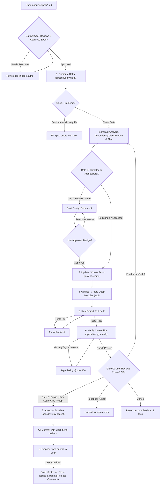

# Spec-Sync Protocol

This document defines the strict execution protocol for the `spec-sync` agent skill.
When the user edits the Markdown specification in `spec/` and asks to sync or build, follow these stages sequentially.
For architectural design principles and vocabulary, see [codebase-design.md](../../spec-author/references/codebase-design.md).

## The Sync Lifecycle



---

## Step-by-Step Execution Guide

### 1. Delta Detection & Spec Review Verification
Run:
```bash
python scripts/specdrive.py delta
```
Inspect the output:
- **Baseline**: Note the last sync commit. If none exists, this is initial generation (all requirements are `ADDED`).
- **Classifications**:
  - `ADDED <ID>`: Brand new requirement. Requires new test(s) and implementation.
  - `MODIFIED <ID>`: Existing requirement updated. Review the unified diff to see what behavioral constraints or acceptance criteria changed. Update existing tests and implementation.
  - `REMOVED <ID>`: Requirement retired. Remove or update corresponding tests and code. Clean up dead code.
  - `MOVED <ID>`: Requirement relocated to a different feature file; content unchanged. Update references if needed.
  - `[context]`: Structural or architectural changes (e.g. `architecture.md`). Assess global impacts.
- **Spec Review Gate**: Verify that the user has reviewed and approved the spec changes before proceeding with synchronization.

### 2. Code Drift Check
Run:
```bash
python scripts/specdrive.py status
```
If code drift shows files modified outside of a sync:
- Alert the user if someone edited `src/` directly without updating `spec/`.
- In a spec-as-source project, intentional changes must be reflected in `spec/` first.

### 2b. Associated Issue Check
Before proceeding to implementation:
- Check if the requirements being synchronized are associated with an issue (e.g. noted in `spec/` `Notes:` or specified by the user).
- If the current work does **not** have an associated issue:
  - If the user already instructed the `spec-author` skill to proceed with this work without an associated issue, **do not ask the user again**.
  - Otherwise, propose creating one or more new issues for the current work.
  - **Proceeding without an associated issue is always an option**: always present this choice.
  - **Mandatory Confirmation Gate**: Never create an issue without explicit user confirmation.

### 2c. Dependency Classification & Seam Discipline
Before touching code:
1. **Classify Dependencies**: Map all affected dependencies into the 4 categories:
   - *In-process*: Pure computation/in-memory state. No I/O. Always merge and test directly.
   - *Local-substitutable*: Stand-in exists (e.g., SQLite, PGLite, in-memory fs). Test with stand-in; internal seam.
   - *Remote but owned*: Microservices, internal APIs across network. Define port at seam; production adapter + in-memory test adapter.
   - *True external*: 3rd-party services (Stripe, Twilio). Injected port; mock adapter.
2. **Enforce Seam Discipline**:
   - *"One adapter means a hypothetical seam; two adapters means a real one."*
   - Never introduce an abstract port or interface unless at least two concrete adapters exist (e.g., production + in-memory test fake).

### 2d. Design Document & Approval Gate (For Complex / Architectural Syncs)
Assess whether the synchronization requires complex or architectural changes:
1. **Identify Architectural or Complex Changes**:
   - The sync alters `spec/architecture.md`.
   - The sync introduces new subsystems, architectural layers, or modules.
   - The sync changes data persistence formats, storage architectures, or public network protocols.
   - The sync involves a broad, multi-file refactoring across interdependent modules.
2. **Action for Complex / Architectural Changes**:
   - The agent **MUST write a comprehensive Design Document** (as an artifact or structured markdown document).
   - The design document must include:
     - Architecture overview and component interaction flow.
     - New or modified interfaces, data contracts, and schema definitions.
     - Concrete file modification breakdown for `src/` and `test/`.
     - Trade-offs, risks, and alternatives evaluated (using the "Design It Twice" perspective).
   - **Mandatory Approval Gate**: **STOP and present the design document to the user. You MUST obtain explicit user approval on the design document before proceeding to Step 3 or generating any code/tests.**
3. **Action for Simple Code Changes**:
   - If the change is localized, does not affect architecture, and does not require system design changes (e.g., minor bug fix, UI style tweak, adding a simple isolated method or field), the design approval step is bypassed. Inform the user that design approval is bypassed and proceed directly to Step 3.

### 3. Test-First Synthesis
Before touching production code in `src/`:
1. For every `ADDED` or `MODIFIED` requirement:
   - Identify the test file in `test/` (e.g. `test/test_<feature>.py` or `test/<feature>.test.ts`).
   - Add/modify test cases directly mirroring each bullet in the requirement's `Acceptance:` criteria.
   - Decorate each test with `@spec <ID>` in its docstring, name, or preceding comment:
     ```python
     # @spec AUTH-002
     def test_account_lockout_after_five_failed_attempts():
         ...
     ```
2. **The Interface is the Test Surface**:
   - Tests cross the exact same seam callers do.
   - Tests assert on observable outcomes (return values, emitted events, status codes), not internal state.
   - Tests must survive internal implementation refactoring. If a test breaks when internal details change, it was testing past the interface.
3. **Replace, Don't Layer**:
   - When deepening a module or retiring shallow components, delete obsolete unit tests on the retired shallow components.
   - Write clean behavioral tests against the deepened module's interface.
4. For `REMOVED` requirements:
   - Delete or archive obsolete tests referencing that ID.

### 4. Implementation Synthesis
Update `src/`:
1. Implement the minimal necessary logic to satisfy the new/modified tests.
2. **Implement Deep Modules**:
   - Place substantial capability behind a compact interface at a clean seam.
   - Minimize public methods, simplify parameter signatures, and encapsulate internal transitions.
   - Avoid creating shallow 1-to-1 pass-through layers (e.g. controller -> service -> repository wrappers).
3. **Design for Testability**:
   - *Accept dependencies, don't create them*: Pass dependencies into constructors/methods.
   - *Return results, don't produce side effects*: Favor pure functions and explicit result objects.
   - Keep internal seams private to the module implementation; do not expose internal seams through the public interface.
4. Comply strictly with `spec/architecture.md` (directory structure, language idioms, architectural patterns).
5. Annotate major implementing functions, classes, or modules with `@spec <ID>`.
6. If implementation uncovers problems or possible improvements that should be addressed in follow-up work, propose creating new issue(s) and **always ask the user for confirmation** before creating them. When appropriate, add `TODO` comments referencing open issues to `spec/`, `src/`, and `test/`.

### 5. Automated Validation
1. Execute the project's native test runner (as specified in `spec/architecture.md`, e.g. `pytest`, `npm test`, `cargo test`, `go test`).
2. If tests fail, diagnose whether:
   - The implementation has a bug $\rightarrow$ fix `src/`.
   - The test misunderstood the spec acceptance criteria $\rightarrow$ fix `test/`.
   - The spec itself is ambiguous or contradictory $\rightarrow$ pause and ask the user for clarification.

### 6. Traceability & `TODO` Verification
Run:
```bash
python scripts/specdrive.py check
```
This verifies:
- No duplicate requirement IDs exist.
- No requirement headings are missing an ID.
- Every requirement has at least one associated test (`@spec <ID>`).
- No orphan `@spec <ID>` tags exist in code pointing to nonexistent or deleted specs.

Additionally, validate `TODO` comment hygiene across `spec/`, `src/`, and `test/`:
- Ensure any `TODO` comments referencing an issue that has been fixed or closed are removed (or converted to normal non-`TODO` issue references). It is okay to reference fixed or closed issues in regular comments, just not in `TODO` comments.

If errors are found, fix them before proceeding.

### 7. User Review & Approval Gate
Present a concise summary of the synthesized code, created/modified tests, diffs, and verification results to the user.

**Mandatory Code Review Gate**: Ask the User to provide feedback, approve the changes, or cancel the sync:
- **Approved**: Proceed to Step 8 to advance the baseline.
- **Feedback (Spec-Level)**: If the user requests alterations that change requirements, acceptance criteria, or architectural constraints, hand off to `spec-author` to draft the spec changes first.
- **Feedback (Implementation-Level)**: If the user requests code improvements, refactoring, or bug fixes consistent with the existing spec, return to Step 2 to revise code and tests.
- **Cancel**: Revert uncommitted working tree modifications in `src/` and `test/` (e.g., `git restore src/ test/` and remove untracked generated files) to return cleanly to the previous baseline state.

### 8. Commit & Advance Baseline (Explicit User Approval Required)
**`specdrive accept` MUST NEVER be run without explicit user approval.**
Only once all tests pass, traceability passes, and the user has explicitly confirmed approval:
Run:
```bash
python scripts/specdrive.py accept -m "<Brief description of spec changes>"
```
This stages `spec/`, `src/`, `test/` and creates a Git commit containing structured `Spec-Sync:` trailers:
```git
spec-sync: Add password reset and lockout

Spec-Sync: v1
Spec-Added: AUTH-003, AUTH-004
Spec-Modified: AUTH-001
Spec-Removed: AUTH-002
```
The newly created commit automatically becomes the baseline for future spec deltas.

### 9. Propose Submission to Upstream (`spec-submit`)
After the baseline commit is recorded, **propose proceeding with the `spec-submit` skill to the user** (do not execute it automatically):
- Ask the user if they would like to submit the committed changes upstream using `spec-submit`.
- Explain the submission actions `spec-submit` will perform:
  - Push the committed changes to the upstream remote.
  - If code reviews (e.g. GitHub Pull Requests) are required, push the branch, open/update the PR, and annotate its description with platform issue closing keywords (e.g., `Closes #123`, `Fixes #456`) so that issues close automatically when the PR is merged.
  - If pushing directly to a branch without code reviews, close all completely fixed associated issues immediately with an informative closing comment.
  - When pushing or merging release tags, comment `"Fixed in release <version>"` on all issues fixed since the previous release tag.
- Only invoke or proceed with `spec-submit` once the user confirms.
