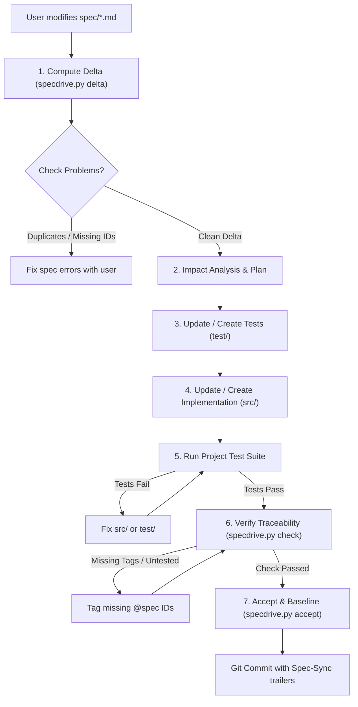

# Spec-Sync Protocol

This document defines the strict execution protocol for the `spec-sync` agent skill.
When the user edits the Markdown specification in `spec/` and asks to sync or build, follow these stages sequentially.

## The Sync Lifecycle



---

## Step-by-Step Execution Guide

### 1. Delta Detection
Run:
```bash
python scripts/specdrive.py delta
```
Inspect the output:
- **Baseline**: Note the last sync commit. If none exists, this is initial generation (all requirements are `ADDED`).
- **Classifications**:
  - `ADDED <ID>`: Brand new requirement. Requires new test(s) and implementation.
  - `MODIFIED <ID>`: Existing requirement updated. Review the unified diff to see what behavioral constraints or acceptance criteria changed. Update existing tests and implementation.
  - `REMOVED <ID>`: Requirement retired. Remove or update corresponding tests and code. Clean up dead code.
  - `MOVED <ID>`: Requirement relocated to a different feature file; content unchanged. Update references if needed.
  - `[context]`: Structural or architectural changes (e.g. `architecture.md`). Assess global impacts.

### 2. Code Drift Check
Run:
```bash
python scripts/specdrive.py status
```
If code drift shows files modified outside of a sync:
- Alert the user if someone edited `src/` directly without updating `spec/`.
- In a spec-as-source project, intentional changes must be reflected in `spec/` first.

### 3. Test-First Synthesis
Before touching production code in `src/`:
1. For every `ADDED` or `MODIFIED` requirement:
   - Identify the test file in `test/` (e.g. `test/test_<feature>.py` or `test/<feature>.test.ts`).
   - Add/modify test cases directly mirroring each bullet in the requirement's `Acceptance:` criteria.
   - Decorate each test with `@spec <ID>` in its docstring, name, or preceding comment:
     ```python
     # @spec AUTH-002
     def test_account_lockout_after_five_failed_attempts():
         ...
     ```
2. For `REMOVED` requirements:
   - Delete or archive obsolete tests referencing that ID.

### 4. Implementation Synthesis
Update `src/`:
1. Implement the minimal necessary logic to satisfy the new/modified tests.
2. Comply strictly with `spec/architecture.md` (directory structure, language idioms, architectural patterns).
3. Annotate major implementing functions, classes, or modules with `@spec <ID>`.

### 5. Automated Validation
1. Execute the project's native test runner (as specified in `spec/architecture.md`, e.g. `pytest`, `npm test`, `cargo test`, `go test`).
2. If tests fail, diagnose whether:
   - The implementation has a bug $\rightarrow$ fix `src/`.
   - The test misunderstood the spec acceptance criteria $\rightarrow$ fix `test/`.
   - The spec itself is ambiguous or contradictory $\rightarrow$ pause and ask the user for clarification.

### 6. Traceability Verification
Run:
```bash
python scripts/specdrive.py check
```
This verifies:
- No duplicate requirement IDs exist.
- No requirement headings are missing an ID.
- Every requirement has at least one associated test (`@spec <ID>`).
- No orphan `@spec <ID>` tags exist in code pointing to nonexistent or deleted specs.

If errors are found, fix them before proceeding.

### 7. Commit & Advance Baseline
Run:
```bash
python scripts/specdrive.py accept -m "<Brief description of spec changes>"
```
This stages `spec/`, `src/`, `test/` and creates a Git commit containing structured `Spec-Sync:` trailers:
```git
spec-sync: Add password reset and lockout

Spec-Sync: v1
Spec-Added: AUTH-003, AUTH-004
Spec-Modified: AUTH-001
Spec-Removed: AUTH-002
```
The newly created commit automatically becomes the baseline for future spec deltas.
