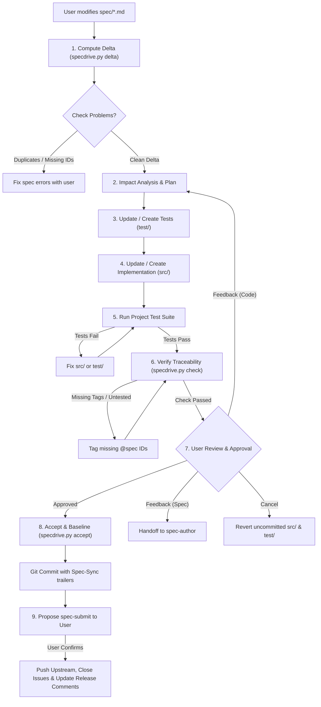

# Spec-Sync Protocol

This document defines the strict execution protocol for the `spec-sync` agent skill.
When the user edits the Markdown specification in `spec/` and asks to sync or build, follow these stages sequentially.

## The Sync Lifecycle



---

## Step-by-Step Execution Guide

### 1. Delta Detection
Run:
```bash
python scripts/specdrive.py delta
```
Inspect the output:
- **Baseline**: Note the last sync commit. If none exists, this is initial generation (all requirements are `ADDED`).
- **Classifications**:
  - `ADDED <ID>`: Brand new requirement. Requires new test(s) and implementation.
  - `MODIFIED <ID>`: Existing requirement updated. Review the unified diff to see what behavioral constraints or acceptance criteria changed. Update existing tests and implementation.
  - `REMOVED <ID>`: Requirement retired. Remove or update corresponding tests and code. Clean up dead code.
  - `MOVED <ID>`: Requirement relocated to a different feature file; content unchanged. Update references if needed.
  - `[context]`: Structural or architectural changes (e.g. `architecture.md`). Assess global impacts.

### 2. Code Drift Check
Run:
```bash
python scripts/specdrive.py status
```
If code drift shows files modified outside of a sync:
- Alert the user if someone edited `src/` directly without updating `spec/`.
- In a spec-as-source project, intentional changes must be reflected in `spec/` first.

### 2b. Associated Issue Check
Before proceeding to implementation:
- Check if the requirements being synchronized are associated with an issue (e.g. noted in `spec/` `Notes:` or specified by the user).
- If the current work does **not** have an associated issue:
  - If the user already instructed the `spec-author` skill to proceed with this work without an associated issue, **do not ask the user again**.
  - Otherwise, propose creating one or more new issues for the current work.
  - **Proceeding without an associated issue is always an option**: always present this choice.
  - **Mandatory Confirmation Gate**: Never create an issue without explicit user confirmation.

### 3. Test-First Synthesis
Before touching production code in `src/`:
1. For every `ADDED` or `MODIFIED` requirement:
   - Identify the test file in `test/` (e.g. `test/test_<feature>.py` or `test/<feature>.test.ts`).
   - Add/modify test cases directly mirroring each bullet in the requirement's `Acceptance:` criteria.
   - Decorate each test with `@spec <ID>` in its docstring, name, or preceding comment:
     ```python
     # @spec AUTH-002
     def test_account_lockout_after_five_failed_attempts():
         ...
     ```
2. For `REMOVED` requirements:
   - Delete or archive obsolete tests referencing that ID.

### 4. Implementation Synthesis
Update `src/`:
1. Implement the minimal necessary logic to satisfy the new/modified tests.
2. Comply strictly with `spec/architecture.md` (directory structure, language idioms, architectural patterns).
3. Annotate major implementing functions, classes, or modules with `@spec <ID>`.
4. If implementation uncovers problems or possible improvements that should be addressed in follow-up work, propose creating new issue(s) and **always ask the user for confirmation** before creating them. When appropriate, add `TODO` comments referencing open issues to `spec/`, `src/`, and `test/`.

### 5. Automated Validation
1. Execute the project's native test runner (as specified in `spec/architecture.md`, e.g. `pytest`, `npm test`, `cargo test`, `go test`).
2. If tests fail, diagnose whether:
   - The implementation has a bug $\rightarrow$ fix `src/`.
   - The test misunderstood the spec acceptance criteria $\rightarrow$ fix `test/`.
   - The spec itself is ambiguous or contradictory $\rightarrow$ pause and ask the user for clarification.

### 6. Traceability & `TODO` Verification
Run:
```bash
python scripts/specdrive.py check
```
This verifies:
- No duplicate requirement IDs exist.
- No requirement headings are missing an ID.
- Every requirement has at least one associated test (`@spec <ID>`).
- No orphan `@spec <ID>` tags exist in code pointing to nonexistent or deleted specs.

Additionally, validate `TODO` comment hygiene across `spec/`, `src/`, and `test/`:
- Ensure any `TODO` comments referencing an issue that has been fixed or closed are removed (or converted to normal non-`TODO` issue references). It is okay to reference fixed or closed issues in regular comments, just not in `TODO` comments.

If errors are found, fix them before proceeding.

### 7. User Review & Approval
Present a concise summary of the synthesized code, created/modified tests, and verification results to the user.
In the case of UI changes, display before and after screenshots that illustrate the changes.

> **IMPORTANT**:
> Never show generated images or mockups instead of actual screenshots. If you don't know how to generate the correct real screenshots then don't show any.

Ask the User to provide feedback, approve the changes, or cancel the sync:
- **Approved**: Proceed to Step 8 to advance the baseline.
- **Feedback (Spec-Level)**: If the user requests alterations that change requirements, acceptance criteria, or architectural constraints, hand off to `spec-author` to draft the spec changes first.
- **Feedback (Implementation-Level)**: If the user requests code improvements, refactoring, or bug fixes consistent with the existing spec, return to Step 2 to revise code and tests.
- **Cancel**: Revert uncommitted working tree modifications in `src/` and `test/` (e.g., `git restore src/ test/` and remove untracked generated files) to return cleanly to the previous baseline state.

### 8. Commit & Advance Baseline
Once all tests pass, traceability passes, and the user has approved the sync:
Run:
```bash
python scripts/specdrive.py accept -m "<Brief description of spec changes>"
```
This stages `spec/`, `src/`, `test/` and creates a Git commit containing structured `Spec-Sync:` trailers:
```git
spec-sync: Add password reset and lockout

Spec-Sync: v1
Spec-Added: AUTH-003, AUTH-004
Spec-Modified: AUTH-001
Spec-Removed: AUTH-002
```
The newly created commit automatically becomes the baseline for future spec deltas.

### 9. Propose Submission to Upstream (`spec-submit`)
After the baseline commit is recorded, **propose proceeding with the `spec-submit` skill to the user** (do not execute it automatically):
- Ask the user if they would like to submit the committed changes upstream using `spec-submit`.
- Explain the submission actions `spec-submit` will perform:
  - Push the committed changes to the upstream remote.
  - If code reviews (e.g. GitHub Pull Requests) are required, push the branch, open/update the PR, and annotate its description with platform issue closing keywords (e.g., `Closes #123`, `Fixes #456`) so that issues close automatically when the PR is merged.
  - If pushing directly to a branch without code reviews, close all completely fixed associated issues immediately with an informative closing comment.
  - When pushing or merging release tags, comment `"Fixed in release <version>"` on all issues fixed since the previous release tag.
- Only invoke or proceed with `spec-submit` once the user confirms.

