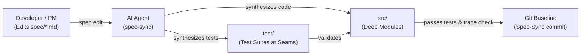

# SpecDrive: Specification-First Development with AI Agents

**SpecDrive** is an AI-native development methodology and toolkit where **Markdown specifications serve as the primary source code**, and programming language files are treated as derived artifacts maintained and compiled by AI coding agents.

Instead of writing syntax-level code line-by-line or relying on unstructured "vibe coding", you define system intent and behavior in structured Markdown. To evolve or fix software, you edit the spec—the AI agent then calculates requirement-level deltas, updates tests, patches implementation code, and verifies system conformance.

---

## Table of Contents

1. [Core Philosophy & Architecture](#core-philosophy--architecture)
2. [Project Directory Layout](#project-directory-layout)
3. [The Developer Workflow](#the-developer-workflow)
   - [1. Starting a New Product or Adopting SpecDrive (`spec-init`)](#1-starting-a-new-product-or-adopting-specdrive-spec-init)
   - [2. Spec Authoring & Iteration (`spec-author`)](#2-spec-authoring--iteration-spec-author)
   - [3. Incremental Synchronization (`spec-sync`)](#3-incremental-synchronization-spec-sync)
   - [4. Verification & Bug Triage (`spec-verify`)](#4-verification--bug-triage-spec-verify)
4. [Specification Syntax & Conventions](#specification-syntax--conventions)
5. [Codebase Design: Deep Modules & Seam Discipline](#codebase-design-deep-modules--seam-discipline)
6. [Traceability (`@spec` Tags)](#traceability-spec-tags)
7. [Agent Skills Suite](#agent-skills-suite)
8. [CLI Helper Reference (`specdrive.py`)](#cli-helper-reference-specdrivepy)
9. [Best Practices: Avoiding Common Pitfalls](#best-practices-avoiding-common-pitfalls)

---

## Core Philosophy & Architecture

Traditional AI coding assistants suffer from **context drift** and **documentation rot**: requirements discussed in chat fade from memory, while external documentation falls out of date as soon as code changes.

SpecDrive solves this by establishing **Specifications as Source (Spec-as-Source)**:



- **Spec is Primary**: Requirements and behavioral contracts live in version-controlled Markdown.
- **Code is Derived**: AI agents generate and update `src/` and `test/` based on changes to `spec/`.
- **Incremental Deltas**: Agents react to *diffs* in requirement sections (`ADDED`, `MODIFIED`, `REMOVED`), rather than rewriting entire projects from scratch.
- **Git-Native Traceability**: Sync baselines are tracked using Git commit trailers (`Spec-Sync:`).

---

## Project Directory Layout

Every SpecDrive project is structured into three clean top-level directories:

```text
my-project/
├── spec/                       # THE SOURCE OF TRUTH (human-maintained)
│   ├── product.md              # Vision, target users, high-level scope, glossary
│   ├── architecture.md         # Stack choices, deep module seams, conventions, test commands (binding)
│   └── features/               # Functional requirement modules
│       ├── auth.md             # E.g. Authentication capabilities
│       └── billing.md          # E.g. Billing capabilities
├── src/                        # DERIVED IMPLEMENTATION (agent-maintained deep modules)
│   └── ...                     # Code organized per architecture.md
├── test/                       # DERIVED TEST SUITE (agent-maintained tests at seams)
│   └── ...                     # Unit, integration, and conformance tests
├── AGENTS.md                   # Always-on instructions for AI coding assistants
└── README.md                   # Project documentation
```

---

## The Developer Workflow

### 1. Starting a New Product or Adopting SpecDrive (`spec-init`)

To use SpecDrive in any new or existing host project, add SpecDrive as a Git submodule and register it with your agent's customization system:

#### A. Add SpecDrive as a Submodule

In your host repository:

```bash
git submodule add https://github.com/junov/SpecDrive.git third_party/specdrive
```

#### B. Configure Skills & Rules (No Copying or Symlinking)

Modern agent systems (Antigravity, Gemini CLI, Claude, Cursor) support **explicit path discovery** for skills and **markdown includes** for rules.

You can configure them manually or via the one-line bootstrap helper:

##### 1. Automated Setup (Recommended)
Run the configuration script:
```bash
python third_party/specdrive/scripts/bootstrap.py
```

##### 2. Manual Setup (What the script does)
* **Register Skill Paths**: Create or update `.agents/skills.json` at your project root to point the agent to SpecDrive's skills directory:
  ```json
  {
    "entries": [
      { "path": "third_party/specdrive/.agents/skills" }
    ]
  }
  ```
  *The agent reads this manifest and scans `third_party/specdrive/.agents/skills` directly. Zero files are copied or symlinked!*

* **Include Rules in `AGENTS.md`**: In your host project's `AGENTS.md` (or `GEMINI.md`), include the SpecDrive guidelines using standard rule inclusion syntax:
  ```markdown
  @[SpecDrive Guidelines](third_party/specdrive/AGENTS.md)
  ```
  *The agent automatically inlines and applies the SpecDrive rules while leaving your other project instructions intact.*

---

#### C. Run `spec-init`

Now open your AI coding assistant in the host project and prompt:
> *"Run spec-init to set up this project."*

The skill automatically detects your project state and executes the appropriate mode:

* **Mode A: Greenfield (Building a New Product from Scratch)**
  If the repository is empty, the agent walks you through a structured discovery interview:
  1. **Vision & Target Users**: Identifies the primary actor, core problem, and project name.
  2. **The Walking Skeleton (Minimal Initial Slice)**: Isolates the *single thinnest vertical slice* delivering end-to-end value on Day 1, while moving secondary ideas to `## Out of scope`.
  3. **Architecture, Seams & Tech Stack**: Confirms language, framework, database, module seams, and test runner (with sensible defaults).
  4. **Drafts Foundational Specifications**: Scaffolds `spec/product.md`, `spec/architecture.md` (recording deep module conventions and dependency categories), and `spec/features/<core-feature>.md` (with concrete EARS requirements and Given/When/Then acceptance criteria).
  5. **Synthesizes Initial Code & Baseline**: Once you approve the draft, the agent generates initial tests in `test/`, minimal deep working code in `src/`, ensures all tests pass, and commits the initial Git baseline:
     ```git
     spec-sync: Initial product implementation: note management
     ```

* **Mode B: Brownfield (Adopting SpecDrive in an Existing Codebase)**
  If existing code and manifests are detected, the agent inspects your codebase:
  1. Scaffolds `spec/`, `spec/features/`, `src/`, and `test/` layouts.
  2. Documents existing technology, module seams, and test commands in `spec/architecture.md` and system context in `spec/product.md`.
  3. Reverse-engineers initial capability specifications in `spec/features/*.md` matching current test cases.
  4. Injects `@spec <ID>` traceability tags into existing tests and implementation.
  5. Commits the initial adoption baseline (`spec-sync: Adopt SpecDrive spec-as-source baseline`).

---

### 2. Spec Authoring & Iteration (`spec-author`)

Whenever you want to build a new feature or change existing behavior:

1. **Edit the Spec**:
   - Open the relevant file in `spec/features/<feature>.md` (or create a new one).
   - Write or update requirements using the [canonical syntax](#specification-syntax--conventions).
   - Use the **`spec-author`** agent skill if you want assistance turning vague product ideas, tickets, or bug reports into rigorous, testable specification text.
   - For major features, leverage **Design It Twice** to explore contrasting interface options before locking in the spec.
2. **Review the Diff (Spec Review Gate)**:
   - Run `python scripts/specdrive.py delta` (or `python third_party/specdrive/scripts/specdrive.py delta` in host projects) to see how the tooling interprets your changes compared to the last sync baseline.
   - **Mandatory Spec Review Gate**: The agent stops after drafting or linting specs to allow you to review assumptions and diffs before progressing to code synchronization.

---

### 3. Incremental Synchronization (`spec-sync`)

Once you have reviewed and approved your spec edits:

1. **Prompt the Agent**:
   > *"I have reviewed and approved the spec changes in `spec/features/auth.md`. Please sync the changes into the codebase."*
2. **The Agent Executes `spec-sync` (Subject to Review & Approval Gates)**:
   - **Calculates Delta**: Determines exactly which requirement IDs were `ADDED`, `MODIFIED`, or `REMOVED`.
   - **Design Document & Approval Gate (Complex/Architectural Syncs)**: If the sync requires complex business logic or architectural modifications (e.g., changes affecting `spec/architecture.md`, new subsystems, or major refactors), the agent produces a design document and **obtains your approval before writing any code or tests**. For simple, localized changes that do not affect architecture, design approval is bypassed.
   - **Updates Tests First (`test/`)**: Derives executable test cases directly from the `Acceptance:` criteria of the spec. *The interface is the test surface.*
   - **Updates Code (`src/`)**: Implements minimal necessary logic to satisfy the new tests, building *deep modules* behind clean seams.
   - **Executes Test Suite**: Runs the project's native test command (`pytest`, `npm test`, `cargo test`, etc.).
   - **Traceability Check**: Ensures every requirement is tested and tags match (`specdrive.py check`).
   - **Code Review Gate**: The agent presents the synthesized code summary, test runner results, and diffs for your review.
   - **Accepts Baseline (Explicit User Approval Required)**: Only after you explicitly approve the code changes does the agent run `specdrive accept` to commit `spec/`, `src/`, and `test/` with structured Git trailers:
     ```git
     spec-sync: Add password reset capability

     Spec-Sync: v1
     Spec-Added: AUTH-004
     Spec-Modified: AUTH-001
     ```

---

### 4. Verification & Bug Triage (`spec-verify`)

If an issue occurs or an automated test fails:

- Ask the agent to run **`spec-verify`**:
  - **Spec Bug vs. Implementation Bug**: If the spec correctly captures intended behavior, the agent fixes `src/`. If the spec missed an edge case or mandated the wrong behavior, the agent prompts you to adjust `spec/` first.
  - **Traceability Audit**: Run `specdrive.py trace` to review full test coverage mapping across all requirements.
  - **Drift Detection**: Detects if any team member accidentally made un-synced manual edits directly to `src/` or `test/`.
  - **Codebase Design & Seam Audit**: Detects shallow pass-through modules, premature seams, or brittle tests reaching past module interfaces.

---

## Specification Syntax & Conventions

Specifications are written in standard GitHub-Flavored Markdown. To make them machine-actionable, adhere to two structural patterns:

### 1. Requirement Heading Structure

Requirements must start with a unique, permanent alphanumeric ID (`PREFIX-NNN`):

```markdown
### AUTH-002: Lock account after repeated failures
```

- **Prefix**: 2–6 uppercase characters identifying the capability (e.g. `AUTH`, `CART`, `API`).
- **Number**: Sequential 3+ digit number (`001`, `002`). **IDs are never reused or renumbered.**
- **Sub-headings**: Any subheadings below this requirement belong to it until the next sibling or higher heading.

### 2. Requirement Body: EARS + Acceptance Criteria

Use the **Easy Approach to Requirements Syntax (EARS)** for clear conditions, followed by **Given/When/Then** acceptance bullets:

```markdown
---
prefix: AUTH
status: active
---
# Authentication Capabilities

## Requirements

### AUTH-001: User Login with Password
WHEN a registered user submits valid email and password credentials,
THE SYSTEM SHALL create an authenticated session cookie and return HTTP 200 with the user profile.

Acceptance:
- Given an existing user with email "alice@example.com" and password "CorrectP@ss",
  when POST /api/login is called with those credentials,
  then response status is 200, "set-cookie" contains a secure session token, and body has `{ "id": 1, "email": "alice@example.com" }`.
- Given an existing user, when POST /api/login is called with an invalid password,
  then response status is 401 and body has error message "Invalid email or password".

### AUTH-002: Account Lockout
IF a user account experiences 5 consecutive failed login attempts within 15 minutes,
THEN THE SYSTEM SHALL lock the account for 15 minutes and reject subsequent login attempts with HTTP 423.

Acceptance:
- Given 5 failed login attempts recorded within the last 10 minutes for "alice@example.com",
  when a 6th login attempt is submitted with the correct password,
  then response status is 423 "Account temporarily locked" and no session is created.
```

---

## Codebase Design: Deep Modules & Seam Discipline

SpecDrive integrates the **Deep Module** and **Seam Discipline** principles (see [codebase-design.md](.agents/skills/spec-author/references/codebase-design.md)). In a Spec-as-Source environment, deep modules and markdown specifications are natural allies: markdown specifications describe substantial behavior at module interfaces, while agents synthesize the deep implementations and test suites.

### 1. Shared Vocabulary
* **Module**: Anything with an interface and an implementation (scale-agnostic: function, class, package, or subsystem).
* **Interface**: Everything a caller must know to use the module correctly (types, invariants, ordering, error modes, configuration).
* **Implementation**: The internal code of a module.
* **Depth**: Leverage at the interface. A module is **deep** when substantial behavior sits behind a compact interface; it is **shallow** when the interface is nearly as complex as the code inside.
* **Seam**: A place where behavior can be altered without editing code in that place; where an interface lives.
* **Adapter**: A concrete entity fulfilling an interface at a seam.
* **Leverage**: The capability callers gain per unit of interface learned.
* **Locality**: Concentration of change, logic, and tests in one place.

### 2. Deep vs. Shallow Modules & The Deletion Test
* **Target Deep Modules**: Small interface with rich hidden logic. Avoid shallow pass-through layers (e.g. controller $\rightarrow$ service $\rightarrow$ repository wrappers that simply forward calls).
* **The Deletion Test**: If you imagine deleting the module, does complexity **reappear across $N$ callers** (deep module earning its keep) or does complexity **vanish** (shallow pass-through adding ceremony without leverage)?

### 3. Designing for Testability
* **Accept dependencies, don't create them**: Inject collaborators at seams/constructors rather than hardcoding instantiations inside.
* **Return results, don't produce side effects**: Prefer pure computation and explicit return objects over ambient mutations.
* **The Interface is the Test Surface**: Callers and tests cross the exact same seam. Tests verify observable outcomes through the public interface, never internal state or private functions.
* **Replace, Don't Layer**: When deepening shallow modules, delete obsolete unit tests on retired shallow components and test through the deepened interface.

### 4. Dependency Categories & Seam Discipline
Classify all dependencies into 4 categories:
1. **In-process**: Pure computation/in-memory state $\rightarrow$ merge and test directly. No adapter needed.
2. **Local-substitutable**: Stand-in exists (SQLite, PGLite, in-memory fs) $\rightarrow$ test with stand-in; internal seam.
3. **Remote but owned (Ports & Adapters)**: Internal network services $\rightarrow$ define port at seam, production adapter + in-memory test adapter.
4. **True external (Mock)**: 3rd-party services (Stripe, Twilio) $\rightarrow$ injected port + mock adapter.

> **Seam Discipline**: *"One adapter means a hypothetical seam; two adapters means a real one."* Never introduce an abstract port or interface unless at least two concrete adapters exist (typically production + test stand-in).

---

## Traceability (`@spec` Tags)

To maintain bi-directional traceability between specifications and executable artifacts, AI agents annotate generated tests and code with `@spec <ID>` tags.

### In Tests (`test/`)
Every test case verifying a requirement is tagged:

```python
# Python (pytest)
# @spec AUTH-002
def test_lockout_after_five_failed_attempts(client):
    ...
```

```typescript
// TypeScript (Jest / Vitest)
// @spec AUTH-001
test('user login with valid credentials', async () => {
  ...
});
```

### In Source Code (`src/`)
Primary implementation modules, controllers, or functions carry the corresponding tag:

```python
# @spec AUTH-001, AUTH-002
def authenticate_user(email: str, password: str) -> Session:
    ...
```

The CLI tool checks that every requirement in `spec/` is verified by at least one test, and alerts you if any orphan tags reference non-existent or retired requirements.

---

## Agent Skills Suite

SpecDrive equips AI agents with specialized skills located under `.agents/skills/`:

| Skill | Description | Primary Use Case |
|---|---|---|
| **`spec-init`** | Bootstraps a project into the SpecDrive methodology. | Starting a new product from scratch (interview, walking skeleton, deep modules, initial specs, tests, and code) *or* adopting SpecDrive in an existing codebase. |
| **`spec-author`** | Guides specification authoring, formatting, and quality checks without modifying source code. | Drafting new features, exploring alternative interfaces with **Design It Twice**, refining acceptance criteria, linting spec diffs. Enforces the **Spec Review Gate**. |
| **`spec-sync`** | The incremental compilation engine that translates spec deltas into code and tests. | Synchronizing edits from `spec/` into `src/` and `test/`, building deep modules behind clean seams, executing tests, advancing git baseline. Enforces **Design Approval**, **Code Review**, and **Explicit Approval to Accept**. |
| **`spec-verify`** | Audits traceability, detects unauthorized code drift, audits module depth/seams, and triages defects. | Running traceability audits, auditing module depth and seam discipline, diagnosing whether a bug is a spec flaw vs. code defect. |
| **`spec-submit`** | Upstream submission and issue management engine. | Pushing committed changes upstream, managing pull requests with issue-closing annotations (`Closes #123`), and annotating releases. |

---

## CLI Helper Reference (`specdrive.py`)

A portable Python (3.8+ standard library) CLI tool is provided at `scripts/specdrive.py` (or `third_party/specdrive/scripts/specdrive.py` in host projects). It requires no third-party dependencies and interacts directly with Git.

| Command | Description | Example |
|---|---|---|
| `status` | Summarizes pending spec changes and un-synced code drift. | `python scripts/specdrive.py status` |
| `delta` | Displays requirement-level diffs (`ADDED`, `MODIFIED`, `REMOVED`) vs. baseline. | `python scripts/specdrive.py delta` |
| `trace` | Outputs the traceability matrix linking requirements to tests and code. | `python scripts/specdrive.py trace [--id ID]` |
| `check` | Validates integrity: fails if requirements are untested, duplicated, or missing IDs. | `python scripts/specdrive.py check` |
| `next-id` | Allocates the next available requirement ID for a prefix (accounting for history). | `python scripts/specdrive.py next-id AUTH` |
| `accept` | Stages `spec/`, `src/`, and `test/` and commits with `Spec-Sync:` trailers (requires explicit user approval). | `python scripts/specdrive.py accept -m "Add lockout"` |
| `log` | Displays the history of all specification synchronization commits. | `python scripts/specdrive.py log` |
| `init` | Ensures `spec/`, `src/`, and `test/` folders exist. | `python scripts/specdrive.py init` |

---

## Best Practices: Avoiding Common Pitfalls

1. **Build Deep Modules, Not Shallow Wrappers**:
   Resist creating chains of 1-to-1 pass-through layers (controllers calling single-method services calling single-method repositories). Hide complexity inside cohesive, deep modules behind clean seams.
2. **The Interface is the Test Surface**:
   Test through the module's public interface, not its internal implementation state or private helpers. Tests should describe behavior and survive internal refactoring.
3. **Respect Review & Approval Gates**:
   Never skip the spec review before syncing or code review before accepting. For complex or architectural changes, always obtain design approval before implementation.
4. **Avoid the "Markdown Avalanche"**:
   Keep specifications concise, structured, and focused on *observable behavior*. Avoid writing multi-page narrative essays. Defer language idioms and technical details to `spec/architecture.md`.
5. **Small, Atomic Deltas**:
   Keep spec changes small and cohesive. An edit modifying 2–5 requirements is faster for agents to synthesize and easier for humans to review than altering 40 requirements at once.
6. **Never "Quick Fix" Code Directly**:
   If a bug appears in production or testing, resist the urge to edit `src/` directly without touching `spec/`. Update the acceptance criteria in `spec/` first, then trigger `spec-sync`. This guarantees your spec remains the authoritative single source of truth.
7. **Concrete Acceptance Criteria**:
   Vague phrases like *"the response should be fast and user-friendly"* lead to agent hallucinations. Always write concrete criteria: *"response status is 200 within 250ms and includes payload `{ status: 'ok' }`"*.
