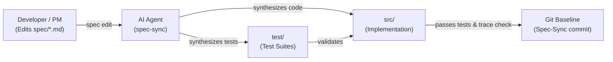

# SpecDrive: Specification-First Development with AI Agents

**SpecDrive** is an AI-native development methodology and toolkit where **Markdown specifications serve as the primary source code**, and programming language files are treated as derived artifacts maintained and compiled by AI coding agents.

Instead of writing syntax-level code line-by-line or relying on unstructured "vibe coding", you define system intent and behavior in structured Markdown. To evolve or fix software, you edit the spec—the AI agent then calculates requirement-level deltas, updates tests, patches implementation code, and verifies system conformance.

---

## Table of Contents

1. [Core Philosophy & Architecture](#core-philosophy--architecture)
2. [Project Directory Layout](#project-directory-layout)
3. [The Developer Workflow](#the-developer-workflow)
   - [1. Starting a New Product or Adopting SpecDrive (`spec-init`)](#1-starting-a-new-product-or-adopting-specdrive-spec-init)
   - [2. Spec Authoring & Iteration (`spec-author`)](#2-spec-authoring--iteration-spec-author)
   - [3. Incremental Synchronization (`spec-sync`)](#3-incremental-synchronization-spec-sync)
   - [4. Verification & Bug Triage (`spec-verify`)](#4-verification--bug-triage-spec-verify)
4. [Specification Syntax & Conventions](#specification-syntax--conventions)
5. [Traceability (`@spec` Tags)](#traceability-spec-tags)
6. [Agent Skills Suite](#agent-skills-suite)
7. [CLI Helper Reference (`specdrive.py`)](#cli-helper-reference-specdrivepy)
8. [Best Practices: Avoiding Common Pitfalls](#best-practices-avoiding-common-pitfalls)

---

## Core Philosophy & Architecture

Traditional AI coding assistants suffer from **context drift** and **documentation rot**: requirements discussed in chat fade from memory, while external documentation falls out of date as soon as code changes.

SpecDrive solves this by establishing **Specifications as Source (Spec-as-Source)**:



- **Spec is Primary**: Requirements and behavioral contracts live in version-controlled Markdown.
- **Code is Derived**: AI agents generate and update `src/` and `test/` based on changes to `spec/`.
- **Incremental Deltas**: Agents react to *diffs* in requirement sections (`ADDED`, `MODIFIED`, `REMOVED`), rather than rewriting entire projects from scratch.
- **Git-Native Traceability**: Sync baselines are tracked using Git commit trailers (`Spec-Sync:`).

---

## Project Directory Layout

Every SpecDrive project is structured into three clean top-level directories:

```text
my-project/
├── spec/                       # THE SOURCE OF TRUTH (human-maintained)
│   ├── product.md              # Vision, target users, high-level scope, glossary
│   ├── architecture.md         # Stack choices, layout conventions, test commands (binding)
│   └── features/               # Functional requirement modules
│       ├── auth.md             # E.g. Authentication capabilities
│       └── billing.md          # E.g. Billing capabilities
├── src/                        # DERIVED IMPLEMENTATION (agent-maintained)
│   └── ...                     # Code organized per architecture.md
├── test/                       # DERIVED TEST SUITE (agent-maintained)
│   └── ...                     # Unit, integration, and conformance tests
├── AGENTS.md                   # Always-on instructions for AI coding assistants
└── README.md                   # Project documentation
```

---

## The Developer Workflow

### 1. Starting a New Product or Adopting SpecDrive (`spec-init`)

To use SpecDrive in any new or existing host project, add SpecDrive as a Git submodule and register it with your agent's customization system:

#### A. Add SpecDrive as a Submodule

In your host repository:

```bash
git submodule add https://github.com/junov/SpecDrive.git third_party/specdrive
```

#### B. Configure Skills & Rules (No Copying or Symlinking)

Modern agent systems (Antigravity, Gemini CLI, Claude, Cursor) support **explicit path discovery** for skills and **markdown includes** for rules.

You can configure them manually or via the one-line bootstrap helper:

##### 1. Automated Setup (Recommended)
Run the configuration script:
```bash
python third_party/specdrive/scripts/bootstrap.py
```

##### 2. Manual Setup (What the script does)
* **Register Skill Paths**: Create or update `.agents/skills.json` at your project root to point the agent to SpecDrive's skills directory:
  ```json
  {
    "entries": [
      { "path": "third_party/specdrive/.agents/skills" }
    ]
  }
  ```
  *The agent reads this manifest and scans `third_party/specdrive/.agents/skills` directly. Zero files are copied or symlinked!*

* **Include Rules in `AGENTS.md`**: In your host project's `AGENTS.md` (or `GEMINI.md`), include the SpecDrive guidelines using standard rule inclusion syntax:
  ```markdown
  @[SpecDrive Guidelines](third_party/specdrive/AGENTS.md)
  ```
  *The agent automatically inlines and applies the SpecDrive rules while leaving your other project instructions intact.*

---

#### C. Run `spec-init`

Now open your AI coding assistant in the host project and prompt:
> *"Run spec-init to set up this project."*

The skill automatically detects your project state and executes the appropriate mode:

* **Mode A: Greenfield (Building a New Product from Scratch)**
  If the repository is empty, the agent walks you through a structured discovery interview:
  1. **Vision & Target Users**: Identifies the primary actor, core problem, and project name.
  2. **The Walking Skeleton (Minimal Initial Slice)**: Isolates the *single thinnest vertical slice* delivering end-to-end value on Day 1, while moving secondary ideas to `## Out of scope`.
  3. **Tech Stack & Architecture**: Confirms language, web/CLI framework, database, and test runner (with sensible defaults).
  4. **Drafts Foundational Specifications**: Scaffolds `spec/product.md`, `spec/architecture.md`, and `spec/features/<core-feature>.md` (with concrete EARS requirements and Given/When/Then acceptance criteria).
  5. **Synthesizes Initial Code & Baseline**: Once you approve the draft, the agent generates initial tests in `test/`, minimal working code in `src/`, ensures all tests pass, and commits the initial Git baseline:
     ```git
     spec-sync: Initial product implementation: note management
     ```

* **Mode B: Brownfield (Adopting SpecDrive in an Existing Codebase)**
  If existing code and manifests are detected, the agent inspects your codebase:
  1. Scaffolds `spec/`, `spec/features/`, `src/`, and `test/` layouts.
  2. Documents existing technology and test commands in `spec/architecture.md` and system context in `spec/product.md`.
  3. Reverse-engineers initial capability specifications in `spec/features/*.md` matching current test cases.
  4. Injects `@spec <ID>` traceability tags into existing tests and implementation.
  5. Commits the initial adoption baseline (`spec-sync: Adopt SpecDrive spec-as-source baseline`).

---

### 2. Spec Authoring & Iteration (`spec-author`)

Whenever you want to build a new feature or change existing behavior:

1. **Edit the Spec**:
   - Open the relevant file in `spec/features/<feature>.md` (or create a new one).
   - Write or update requirements using the [canonical syntax](#specification-syntax--conventions).
   - Use the **`spec-author`** agent skill if you want assistance turning vague product ideas, tickets, or bug reports into rigorous, testable specification text.
2. **Review the Diff**:
   - Run `python scripts/specdrive.py delta` (or `python third_party/specdrive/scripts/specdrive.py delta` in host projects) to see how the tooling interprets your changes compared to the last sync baseline.

---

### 3. Incremental Synchronization (`spec-sync`)

Once you are satisfied with your spec edits:

1. **Prompt the Agent**:
   > *"I have updated `spec/features/auth.md`. Please sync the changes into the codebase."*
2. **The Agent Executes `spec-sync`**:
   - **Calculates Delta**: Determines exactly which requirement IDs were `ADDED`, `MODIFIED`, or `REMOVED`.
   - **Updates Tests First (`test/`)**: Derives executable test cases directly from the `Acceptance:` criteria of the spec.
   - **Updates Code (`src/`)**: Implements minimal necessary logic to satisfy the new tests.
   - **Executes Test Suite**: Runs the project's native test command (`pytest`, `npm test`, `cargo test`, etc.).
   - **Traceability Check**: Ensures every requirement is tested and tags match (`specdrive.py check`).
   - **Records Baseline**: Automatically commits `spec/`, `src/`, and `test/` with structured Git trailers:
     ```git
     spec-sync: Add password reset capability

     Spec-Sync: v1
     Spec-Added: AUTH-004
     Spec-Modified: AUTH-001
     ```

---

### 4. Verification & Bug Triage (`spec-verify`)

If an issue occurs or an automated test fails:

- Ask the agent to run **`spec-verify`**:
  - **Spec Bug vs. Implementation Bug**: If the spec correctly captures intended behavior, the agent fixes `src/`. If the spec missed an edge case or mandated the wrong behavior, the agent prompts you to adjust `spec/` first.
  - **Traceability Audit**: Run `specdrive.py trace` to review full test coverage mapping across all requirements.
  - **Drift Detection**: Detects if any team member accidentally made un-synced manual edits directly to `src/` or `test/`.

---

## Specification Syntax & Conventions

Specifications are written in standard GitHub-Flavored Markdown. To make them machine-actionable, adhere to two structural patterns:

### 1. Requirement Heading Structure

Requirements must start with a unique, permanent alphanumeric ID (`PREFIX-NNN`):

```markdown
### AUTH-002: Lock account after repeated failures
```

- **Prefix**: 2–6 uppercase characters identifying the capability (e.g. `AUTH`, `CART`, `API`).
- **Number**: Sequential 3+ digit number (`001`, `002`). **IDs are never reused or renumbered.**
- **Sub-headings**: Any subheadings below this requirement belong to it until the next sibling or higher heading.

### 2. Requirement Body: EARS + Acceptance Criteria

Use the **Easy Approach to Requirements Syntax (EARS)** for clear conditions, followed by **Given/When/Then** acceptance bullets:

```markdown
---
prefix: AUTH
status: active
---
# Authentication Capabilities

## Requirements

### AUTH-001: User Login with Password
WHEN a registered user submits valid email and password credentials,
THE SYSTEM SHALL create an authenticated session cookie and return HTTP 200 with the user profile.

Acceptance:
- Given an existing user with email "alice@example.com" and password "CorrectP@ss",
  when POST /api/login is called with those credentials,
  then response status is 200, "set-cookie" contains a secure session token, and body has `{ "id": 1, "email": "alice@example.com" }`.
- Given an existing user, when POST /api/login is called with an invalid password,
  then response status is 401 and body has error message "Invalid email or password".

### AUTH-002: Account Lockout
IF a user account experiences 5 consecutive failed login attempts within 15 minutes,
THEN THE SYSTEM SHALL lock the account for 15 minutes and reject subsequent login attempts with HTTP 423.

Acceptance:
- Given 5 failed login attempts recorded within the last 10 minutes for "alice@example.com",
  when a 6th login attempt is submitted with the correct password,
  then response status is 423 "Account temporarily locked" and no session is created.
```

---

## Traceability (`@spec` Tags)

To maintain bi-directional traceability between specifications and executable artifacts, AI agents annotate generated tests and code with `@spec <ID>` tags.

### In Tests (`test/`)
Every test case verifying a requirement is tagged:

```python
# Python (pytest)
# @spec AUTH-002
def test_lockout_after_five_failed_attempts(client):
    ...
```

```typescript
// TypeScript (Jest / Vitest)
// @spec AUTH-001
test('user login with valid credentials', async () => {
  ...
});
```

### In Source Code (`src/`)
Primary implementation modules, controllers, or functions carry the corresponding tag:

```python
# @spec AUTH-001, AUTH-002
def authenticate_user(email: str, password: str) -> Session:
    ...
```

The CLI tool checks that every requirement in `spec/` is verified by at least one test, and alerts you if any orphan tags reference non-existent or retired requirements.

---

## Agent Skills Suite

SpecDrive equips AI agents with four specialized skills located under `.agents/skills/`:

| Skill | Description | Primary Use Case |
|---|---|---|
| **`spec-init`** | Bootstraps a project into the SpecDrive methodology. | Starting a new product from scratch (interview, walking skeleton, initial specs, tests, and code) *or* adopting SpecDrive in an existing codebase. |
| **`spec-author`** | Guides specification authoring, formatting, and quality checks without modifying source code. | Drafting new features, refining acceptance criteria, formatting EARS statements, linting spec diffs. |
| **`spec-sync`** | The incremental compilation engine that translates spec deltas into code and tests. | Synchronizing edits from `spec/` into `src/` and `test/`, executing tests, advancing git baseline. |
| **`spec-verify`** | Audits traceability, detects unauthorized code drift, and triages defects. | Running traceability audits, diagnosing whether a bug is a spec flaw vs. code defect. |

---

## CLI Helper Reference (`specdrive.py`)

A portable Python (3.8+ standard library) CLI tool is provided at `scripts/specdrive.py` (or `third_party/specdrive/scripts/specdrive.py` in host projects). It requires no third-party dependencies and interacts directly with Git.

| Command | Description | Example |
|---|---|---|
| `status` | Summarizes pending spec changes and un-synced code drift. | `python scripts/specdrive.py status` |
| `delta` | Displays requirement-level diffs (`ADDED`, `MODIFIED`, `REMOVED`) vs. baseline. | `python scripts/specdrive.py delta` |
| `trace` | Outputs the traceability matrix linking requirements to tests and code. | `python scripts/specdrive.py trace [--id ID]` |
| `check` | Validates integrity: fails if requirements are untested, duplicated, or missing IDs. | `python scripts/specdrive.py check` |
| `next-id` | Allocates the next available requirement ID for a prefix (accounting for history). | `python scripts/specdrive.py next-id AUTH` |
| `accept` | Stages `spec/`, `src/`, `test/` and commits with `Spec-Sync:` trailers. | `python scripts/specdrive.py accept -m "Add lockout"` |
| `log` | Displays the history of all specification synchronization commits. | `python scripts/specdrive.py log` |
| `init` | Ensures `spec/`, `src/`, and `test/` folders exist. | `python scripts/specdrive.py init` |

---

## Best Practices: Avoiding Common Pitfalls

1. **Avoid the "Markdown Avalanche"**:
   Keep specifications concise, structured, and focused on *observable behavior*. Avoid writing multi-page narrative essays. Defer language idioms and technical details to `spec/architecture.md`.
2. **Small, Atomic Deltatons**:
   Keep spec changes small and cohesive. An edit modifying 2–5 requirements is faster for agents to synthesize and easier for humans to review than altering 40 requirements at once.
3. **Never "Quick Fix" Code Directly**:
   If a bug appears in production or testing, resist the urge to edit `src/` directly without touching `spec/`. Update the acceptance criteria in `spec/` first, then trigger `spec-sync`. This guarantees your spec remains the authoritative single source of truth.
4. **Concrete Acceptance Criteria**:
   Vague phrases like *"the response should be fast and user-friendly"* lead to agent hallucinations. Always write concrete criteria: *"response status is 200 within 250ms and includes payload `{ status: 'ok' }`"*.
